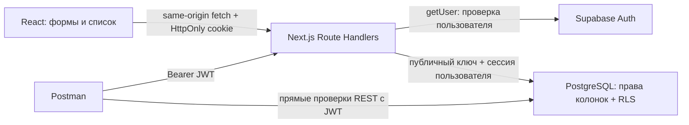

# Архитектура и описание кода

## Поток данных

Страница `/` — статическая оболочка; персональные данные загружаются только из защищённого API с `Cache-Control: no-store`. Cookie изменяются внутри Route Handlers, где Next.js разрешает запись `Set-Cookie`. Отдельный middleware/proxy не нужен: Server Components не читают пользовательскую сессию, а каждое обращение к данным самостоятельно проверяет её. Это осознанное ограничение архитектуры; при добавлении SSR персональных страниц подход к обновлению сессии нужно пересмотреть.

## Модули

| Модуль          | Ответственность                                                                                              |
| --------------- | ------------------------------------------------------------------------------------------------------------ |
| `Portal`        | Получает сессию, переключает вход/рабочее пространство, управляет поиском, фильтром, страницами и редактором |
| `AuthForm`      | Вход и регистрация, браузерная валидация, состояние ожидания, сообщения об ошибках/подтверждении             |
| `RequestEditor` | Создание и изменение заявки, подтверждение закрытия несохранённой формы, блокировка отправки                 |
| `domain.ts`     | Общие перечисления, TS-типы и строгие Zod-схемы API                                                          |
| `supabase.ts`   | Чтение конфигурации, SSR-клиент с cookie, клиент с Bearer, обязательная проверка `auth.getUser()`            |
| `api.ts`        | Общая обработка ошибок, JSON-ответы без кеша, проверка типа/размера тела и Origin                            |
| `http.ts`       | Fetch с cookie того же сайта, преобразование HTTP/сетевых ошибок, поддержка AbortSignal                      |
| Route Handlers  | Авторизация, валидация входа, запрос к Supabase, преобразование результата в HTTP                            |

## Модель заявки

| Поле          | Правило                                                                                    |
| ------------- | ------------------------------------------------------------------------------------------ |
| `id`          | UUID; первичный ключ; приложение генерирует его перед первой отправкой                     |
| `user_id`     | UUID пользователя Supabase Auth; `ON DELETE CASCADE` при удалении аккаунта администратором |
| `title`       | Обязательное название, 1–160 символов после удаления пробелов по краям                     |
| `description` | Обязательное описание, 1–5000 символов                                                     |
| `category`    | `Бот`, `Интеграция`, `Отчёт`, `Другое`                                                     |
| `status`      | `Новая` по умолчанию; затем также `В работе` и `Завершена`                                 |
| `created_at`  | `timestamptz`, устанавливается базой, не изменяется пользователем                          |
| `updated_at`  | `timestamptz`, обновляется триггером                                                       |

Дата показывается по часовому поясу браузера. В базе хранится момент времени, а не строка локальной даты. Категории/статусы хранятся русскими строками в соответствии с текущим небольшим ТЗ. Для мультиязычного продукта можно перейти на машинные коды и отдельные подписи.

## Защита данных

1. API получает пользователя через Supabase Auth. Значения из cookie или JWT не считаются проверенной личностью без `getUser()`.
2. Сервер назначает `user_id` из проверенной сессии. Схемы `.strict()` отклоняют попытки передать защищённые поля.
3. Серверные выборки дополнительно ограничены `user_id`.
4. Независимо от сервера RLS разрешает SELECT/INSERT/UPDATE только для `auth.uid() = user_id`.
5. Права INSERT выданы только на `id,user_id,title,description,category`. Поэтому даже прямой REST-запрос не может создать заявку со статусом `Завершена`.
6. Права UPDATE выданы только на `title,description,category,status`: нельзя менять ID, владельца и служебные даты.
7. DELETE и анонимный доступ не предоставлены. Удаления заявок в ТЗ нет.

В приложении нет `service_role` или административного секрета. Publishable/anon key идентифицирует проект; защита персональных строк обеспечивается JWT, правами и RLS. Проверки базы находятся в `tests/database.test.ts` и в прямых REST-запросах коллекции Postman.

## Сессии

Вход устанавливает HttpOnly + SameSite=Lax cookies; в production используется Secure. Токены не попадают в localStorage и не возвращаются из `/api/auth/login`. При обращении к API SSR-клиент может обновить токены и записать cookie. При отсутствии/истечении сессии API возвращает 401, интерфейс очищает список и показывает вход.

Выход завершает текущую cookie-сессию (`scope: local`). Как у JWT-систем в целом, ранее скопированный access token может оставаться действительным до истечения срока; мгновенное аннулирование каждого access token этим MVP не реализуется. Bearer-клиенты не продлевают сессию автоматически: Postman получает токен заново.

Для write-запросов обязательны JSON и совпадение Origin, если заголовок присутствует. CLI может отправлять JSON без Origin. CORS для сторонних браузерных клиентов не включён. Тела запросов ограничены 32 KiB по реально прочитанным байтам.

Проверка Origin использует протокол URL запроса и фактический заголовок Host. Это учитывает особенность Next.js dev: внутренний URL может содержать `localhost`, хотя браузер обращается к `127.0.0.1`. Другой host, порт или протокол остаются запрещены; `X-Forwarded-Host` не добавляется в список доверенных адресов. Reverse proxy должен сохранять исходный Host и корректный протокол URL запроса.

## Создание без дублей

`RequestEditor` использует синхронный ref-lock и disabled-состояние. UUID сохраняется при сетевой ошибке и повторной отправке формы. PostgreSQL не допускает двух строк с одним ID. При конфликте API читает существующую собственную запись: если название, описание и категория совпадают, возвращает 200 с `replayed: true`; иначе 409. Первое успешное создание возвращает 201.

Это дедупликация по ID создаваемой записи, а не полноценное хранилище идемпотентных операций. Две независимо открытые формы получают разные UUID и могут создать одинаковые по смыслу заявки. Повтор с изменённым содержимым после потерянного ответа может вернуть 409; нужно обновить список и отредактировать уже созданную заявку.

## Список и редактирование

Поиск регистронезависимый по подстроке названия; `%`, `_` и `\` экранируются. Фильтр и поиск выполняются на сервере с учётом RLS. По 20 строк на страницу, сортировка по `created_at DESC, id DESC`. Клиент откладывает поиск на 300 мс, отменяет старые запросы через AbortController и сбрасывает номер страницы при изменении фильтра.

Редактирование использует PATCH разрешённых полей. Отдельная страница просмотра не нужна: строка открывает диалог с полным описанием. При одновременном редактировании в двух вкладках действует последнее сохранение; оптимистические блокировки не входят в текущий объём.

## Как расширять

Новый статус или категория требуют согласованной SQL-миграции, обновления `domain.ts`, отображения и тестов. Персональные поля добавляются через новую миграцию, а не правкой уже применённой. При добавлении административных ролей нельзя использовать общий секрет в браузере; нужны отдельные серверные проверки и политики доступа.
