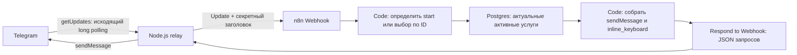

# Устройство решения



## Почему есть relay

Штатный Telegram Trigger в webhook-режиме требует доступного Telegram HTTPS-адреса. Для локального показа вместо туннеля используется Bot API `getUpdates`. Relay передаёт события в n8n и отправляет готовые результаты. Список услуг, фильтрация и создание клавиатуры исполняются **в n8n**, не в relay. Сервис transport нужен для локального способа доставки, поэтому входит в передаваемый комплект.

Relay сразу вызывает `answerCallbackQuery`, чтобы остановить индикатор ожидания у кнопки. Затем передаёт callback в n8n. Callback содержит `svc:<UUID>`, а не имя или индекс услуги. Никакие названия из текста старого сообщения не используются как источник данных.

## Таблица

База `latte_catalog`, схема `catalog`, таблица `services`:

| Поле | Тип | Назначение |
| --- | --- | --- |
| `id` | UUID, PRIMARY KEY | Стабильный уникальный ID услуги |
| `name` | varchar(200), NOT NULL | Название, непустое после удаления крайних пробелов |
| `active` | boolean, NOT NULL | Включение в меню |
| `sort_order` | integer, NOT NULL | Дополнительное поле для предсказуемого порядка |

В начальных данных ID заканчиваются на `000000000001`…`000000000009`. Полный формат: `00000000-0000-4000-8000-000000000001`. Названия:

1. Бот для записи клиентов — активна.
2. Интеграция CRM с сайтом — активна.
3. Ежедневный отчёт о продажах.
4. Уведомления о новых заявках.
5. Синхронизация остатков.
6. Напоминания о встречах.
7. Сбор обратной связи.
8. Выгрузка заказов в таблицу.
9. Проверка качества данных.

Остальные семь изначально неактивны. При добавлении через скрипт генерируется новый UUID. Переименование сохраняет ID; удаление и повторное добавление создают новую услугу с новым ID.

## Чтение и формирование ответа

При каждом `/start` workflow выполняет SELECT активных строк в стабильном порядке. Агрегат возвращает `[]`, если строк нет: Code-узел всё равно запускается и формирует понятное сообщение без клавиатуры.

При callback выполняется SELECT актуальной активной строки с нужным ID. SQL использует `$1`/`$2` и Query Parameters, а не вставку callback-строки в SQL. Дополнительно callback проверяется на формат UUID. Удалённая/отключённая услуга возвращает сообщение «Эта услуга больше недоступна. Обновите меню: /start».

Для каждой строки Code создаёт `{text: name, callback_data: 'svc:' + id}`. Каждая услуга занимает одну строку клавиатуры. Большие каталоги делятся по 50 услуг на сообщение: все активные услуги остаются доступны. UUID вместе с префиксом занимает 40 ASCII-байт, укладываясь в ограничение Telegram callback_data 1–64 байта.

Сообщения отправляются без HTML/Markdown parse mode, поэтому символы `<`, `&`, кавычки и апострофы в названиях не становятся разметкой. Каталог ограничивает название 200 символами.

## Границы доступа

- n8n подключается к каталогу ролью `latte_reader`, которой разрешён только SELECT таблицы.
- Webhook требует правильный `X-Latte-Secret`. Relay и credentials получают одно значение из локальной подготовки.
- Редактор n8n привязан к loopback. База доступна только внутри сети Docker.
- Workflow не содержит токена Telegram. Токен получает только relay из `.env`.
- Relay допускает только `sendMessage` в исходный личный чат; ответ workflow не может отправлять сообщение произвольному получателю или вызывать другой Telegram-метод.
- Контроль допустимых пользователей выполняется до webhook. Группы и сообщения от других ботов игнорируются.
- История успешных, ошибочных и ручных выполнений workflow отключена настройками, чтобы не хранить идентификаторы Telegram в execution-данных. Локальные журналы не включают токен и текст сообщений.

Обычные пользователи n8n с правом менять workflow всё равно должны считаться доверенными администраторами этой локальной системы.

## Хранение и перезапуск

`catalog_data` хранит услуги. `n8n_data` — SQLite n8n, workflow, зашифрованные credentials и первоначальную отметку импорта. `relay_state` хранит offset Telegram. Offset сохраняется после обработки update; при неопределённом исходе сетевой отправки редкое повторное сообщение возможно.

Изменения `.env` применяются при пересоздании соответствующего контейнера. Обычный `docker compose restart` не обновляет переменные окружения из файла. Передавайте токен через `docker compose up -d --force-recreate telegram-relay`.

## Изменение workflow разработчиком

Сначала изменить `src/domain.mjs`, прогнать тесты и выполнить `npm run generate`. Новая версия JSON не импортируется поверх пользовательских изменений автоматически при каждом рестарте. Для осознанного обновления своего тестового workflow:

```powershell
docker compose stop telegram-relay n8n
docker compose run --rm --no-deps --entrypoint n8n n8n import:workflow --input=/bootstrap/workflow.json
docker compose run --rm --no-deps --entrypoint n8n n8n publish:workflow --id=ldLatteDynamicMenu
docker compose up -d
```

Эти команды меняют только workflow данного проекта. Изменения названий, активности и числа услуг к этой процедуре не относятся.

## Официальные источники

- [Telegram Bot API](https://core.telegram.org/bots/api): `getUpdates`, `sendMessage`, `answerCallbackQuery`, inline keyboard.
- [Telegram Bots FAQ](https://core.telegram.org/bots/faq): polling нельзя использовать одновременно с активным webhook.
- [Официальный n8n Docker/Postgres пример](https://github.com/n8n-io/n8n-hosting/tree/main/docker-compose/withPostgres): варианты контейнерного развёртывания; здесь SQLite n8n и отдельный каталог PostgreSQL.
- [n8n 2.46.6](https://github.com/n8n-io/n8n/releases/tag/n8n%402.46.6): проверенная версия.
- Исходный код n8n 2.46.6 проверен для Query Parameters Postgres и команды `publish:workflow`.
